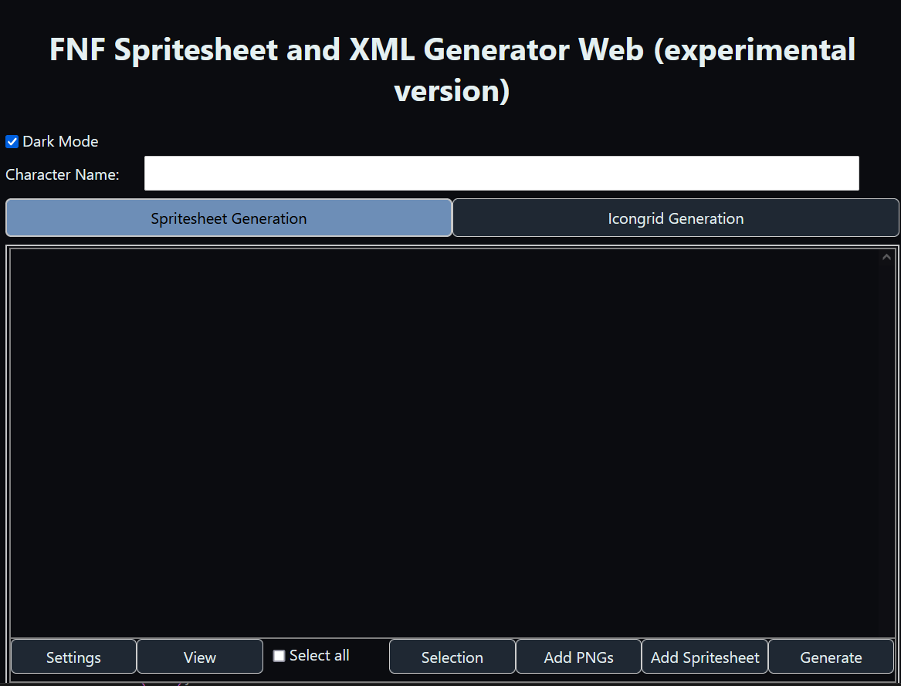
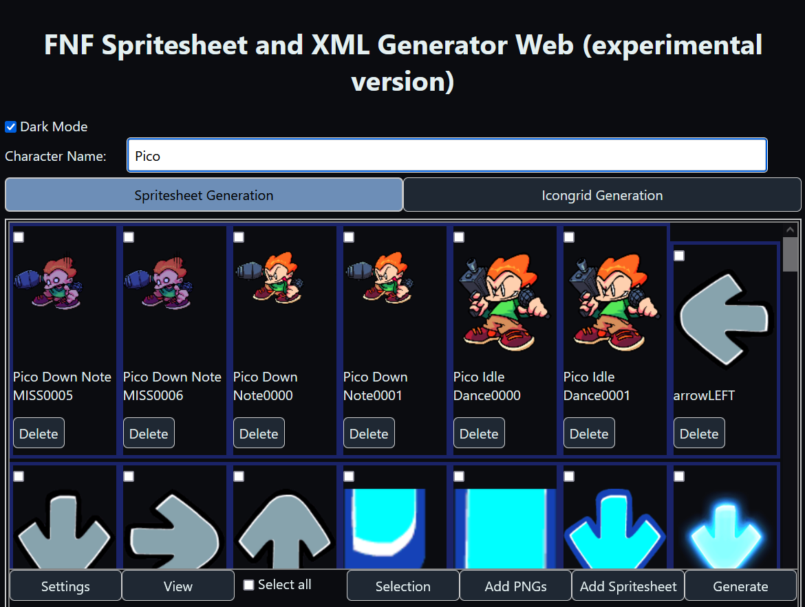
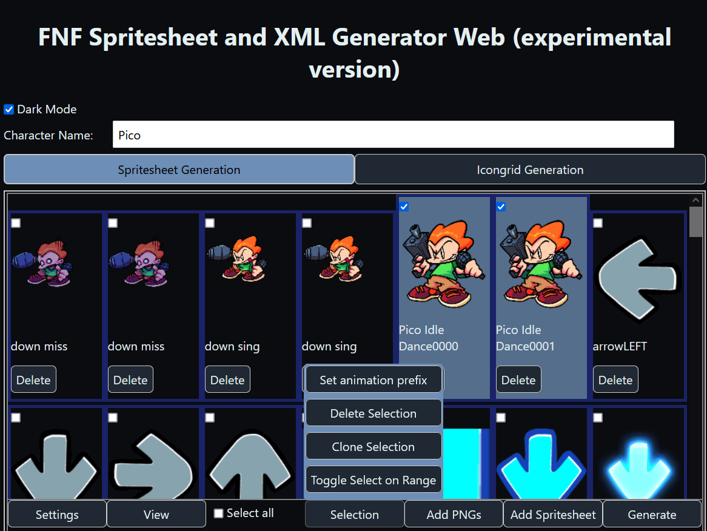
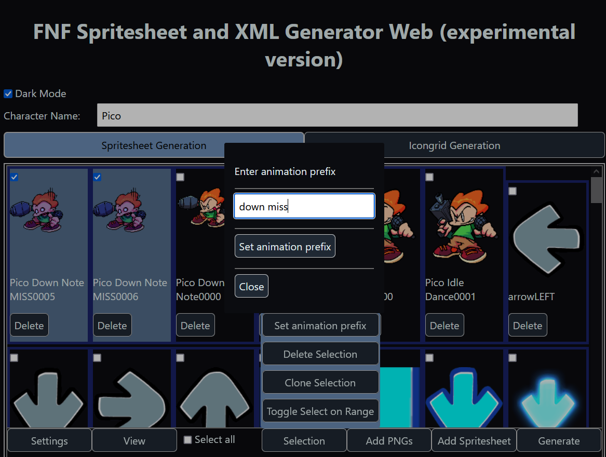
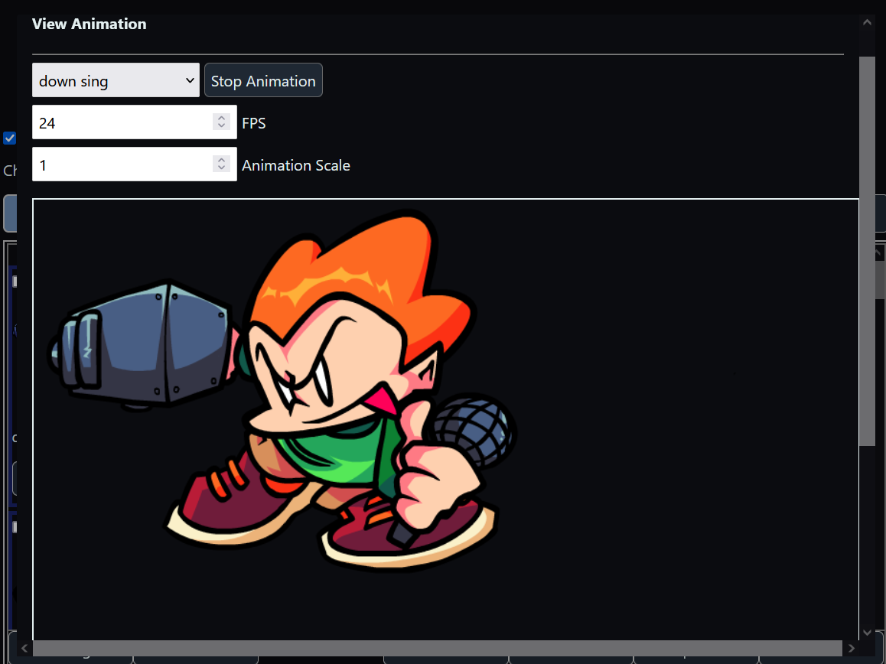
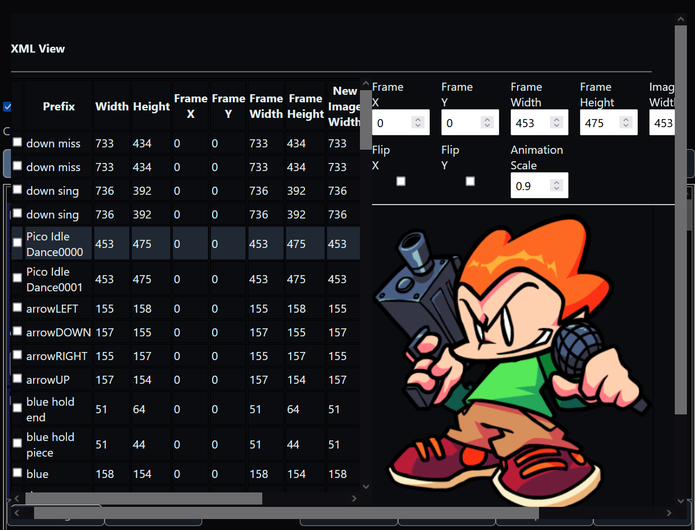
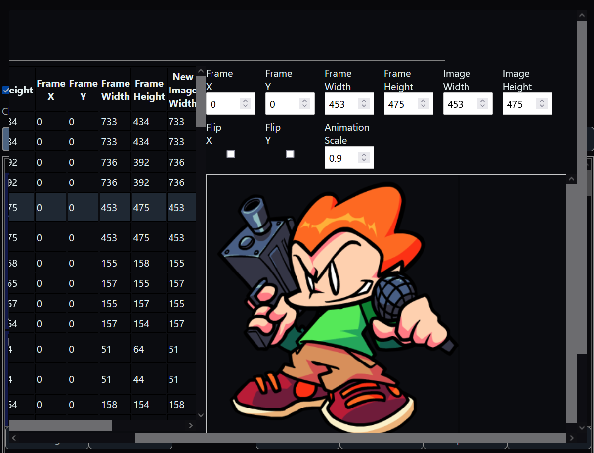

# FnF-Spritesheet-and-XML-Maker-Web
An (experimental) online version of the [FnF-Spritesheet-and-XML-Maker](https://github.com/UncertainProd/FnF-Spritesheet-and-XML-Maker), A Friday Night Funkin' mod making helper tool that allows you to generate XML files and spritesheets from individual pngs. This is a free and open-source mini-replacement tool to the "Generate Spritesheet" functionality in Adobe Animate/Flash

### This tool can be used online by following [this link](https://uncertainprod.github.io/FNF-Spritesheet-XML-generator-Web). Tested mainly on Chrome and Firefox browsers

---
## Hat Packer (UI redesign)
This copy is a tablet-first UI/UX redesign of [UncertainProd/FNF-Spritesheet-XML-generator-Web](https://github.com/UncertainProd/FNF-Spritesheet-XML-generator-Web) (MIT, see `LICENSE`). The Rust/WASM image processing, the PNG/XML generation and the data model are unchanged; only the interface layer (`svelte-frontend/src` components, `src/styles.css`, `public/global.css`, `public/index.html`) was reworked:

- app shell sized to the viewport (no page scroll, only the panels scroll), safe for iPad portrait + landscape
- one set of design tokens for Dark / Light mode (`src/styles.css`), a shared inline SVG icon set (`components/Icon.svelte`)
- header with app name, character name, mode tabs and theme toggle; both modes stay mounted so switching tabs keeps your frames
- frame grid with selection state, frame/selection counts, an empty state, and a per-card delete button that does not interfere with selecting
- inline error / status messages instead of `alert()` popups, and a guard against starting a second generation while one is running
- responsive modals: Animation Preview (canvas is sized to its area) and XML Inspector (table + grouped fields)

### v1.1.0 - import, ordering and auto-trim
- **Add ZIP**: import PNGs from a `.zip` (sub-folders are searched; an XML is used only if it matches a PNG inside the ZIP, otherwise ignored). Limits: ZIP 150 MB, 5000 entries, 1000 images per import, 25 MB per image, 600 MB inflated in total. Everything is processed in memory; nothing is written to the file system.
- **Order**: new images are natural-sorted (frame2 before frame10; ZIPs by path) and appended after the existing frames. Existing frames are never re-sorted automatically; use the *Order* menu to move frames or to sort all by name on request. Settings let you use the picker's own order instead.
- **Auto-Trim** (mode: *on Generate*, Settings > Image): transparent borders are cut at export on a copy of each image, original size/offset are kept in the XML (frameX/frameY/frameWidth/frameHeight). Fixed: with the option *off*, frame offsets were shifted by the bounding-box position.
- Mobile file picking: PNG sizes are read from the file header, images are read in small batches, object URLs are released.
- The version is read from `svelte-frontend/package.json` and shown next to the app name.

### v1.2.0 - Chunky 3D buttons
- Buttons use a thick solid bottom edge and sink on press (CSS `transform` + `box-shadow` only, `prefers-reduced-motion` respected). Styles live in `svelte-frontend/src/styles.css` (`--btn-*` tokens, `.btn-primary`, `.btn-danger`, `.btn-flat`).
- Two font roles: the custom UI font `public/fonts/PhantomMuff.ttf` (titles, labels, buttons; Latin only, Thai falls back to the system font) and `system-ui` for text, inputs, tables and XML values.

### v1.2.1 - faster Netlify builds
`netlify.toml` now keeps the Rust toolchain, compiled dependencies and the wasm-bindgen CLI under `/opt/build/cache` so only the first build compiles everything; later builds reuse the cache.

Build/run instructions below are unchanged.

---

## How to generate spritesheet and XML files for your character:

First, the name of your character goes into the textbox at the top. This is necessary as the final xml and png files will be named accordingly.
Eg: If you name you character <b>Pixel-GF</b> the files generated will be named <b>Pixel-GF.png</b> and <b>Pixel-GF.xml</b>
If this box is blank, you will be prompted for a name when generating the spritesheet.

### Adding sprite frames
To add a frames from PNG images, click on `Add PNGs`, and then select all the PNG images you want to insert as frames. 

If you want to extract and add frames from a pre-existing Spritesheet and XML, click on `Add Spritesheet`. It will then prompt you to insert your spritesheet and your XML and extract the frames from it.

Once you have added some frames it will look like this:

 
 
Click on some frames whose animation prefix you want to set and then click the `Set animation prefix` button as shown below:

Once you click the `Set animation prefix` button in the dialog, it will set that animation name for all the frames that are selected.

### Previewing The Animations
By click on `View` > `View Animation`, you can select the name of the animation you want to see and click the play button to play that animation. In case the animation is too big (usually on phone screens), you can change the `Animation Scale` to reduce the size of the animation for better visibility.

### Tweaking the sprite frames
By going into `View` > `View XML structure`, you can change the appearance of each sprite frame. It supports scaling, flipping and changing the values of `frameX`, `frameY`, `frameWidth` and `frameHeight`.

### Generating the final XML and PNG files
When you're done adding all the frames and giving them animation names, it's time to generate the final PNG and XML files!
To do so, just click the "Generate XML" button. This will download a zip file containing the final Spritesheet and the XML. This could take a while depending on how large the input spritesheets/frames are.
 

### Important thing to know when uploading large spritesheets:
Since the app runs entirely in the browser, all images are that are loaded are kept in memory by the browser. So expect the memory usage of your browser to increase (sometimes by a _lot_) when using this app.

Also try not to upload spritesheets that are too big (aka several gigabytes) in size, as there is a chance that it might _really_ slow down (or worse, crash) your browser while the frames are being processed, or while the final spritesheet is being generated.
  

## Making Icons / Icongrids
You can create icons by just clicking on `Add Icons`, then selecting 2 icon png files of size 150 x 150 and then clicking `Generate Icongrid`. This generates an icongrid that can be used.

The app also supports making Icongrids (mainly only used by the pre-week 7 base engine), where you can upload an icongrid, then choose the icons you wish to add and then click `Generate Icongrid`. This legacy feature can be enabled by checking the `Legacy Mode` checkbox.
 
 

## Building the app:
Since this is a web app, there is no need to build this from source if all you intend on doing is using the app. Just use the app [here](https://uncertainprod.github.io/FNF-Spritesheet-XML-generator-Web)

But for developers, you need the [Rust](https://www.rust-lang.org/tools/install) toolchain as well as [Node.js (and npm)](https://nodejs.org/en/download) installed. You also need `wasm-pack` to compile Rust into Webassmebly, follow the instructions [here](https://rustwasm.github.io/docs/book/game-of-life/setup.html) for setting that up.

- To build the app go into the `svelte-frontend` folder and open a command prompt/terminal window in that folder
- Type in `npm install` to automatically install all the dependencies needed for both the Javascript code
- Then type `npm run dev` to start the app in debug mode. In order to build in release mode use `npm run build` instead. The first build will take a while as all the Rust dependencies will have to get downloaded and compiled before building the app.

<small>Note: This app is still in a WIP phase and is not fully fleshed out yet (especially the UI) but it supports pretty much everything that the older application supported</small>

#### Side note: Credit this repo if you are going to make your own fork and stuff :)

## v1.3.0 - Hat Packer
- Renamed to **Hat Packer** (title, header, XML comments only; tags/attributes unchanged). Original credit to UncertainProd (MIT) kept.
- Icons/logo PNGs live in `svelte-frontend/public/assets/icons/` (`favicon.png`, `hat-packer-logo.png`); names/paths are centralized in `svelte-frontend/src/branding.ts`. Replace a file with the same name to change it.
- Auto-Trim now has 3 modes (On import [default] / On Generate / Off). Files are never modified; trimmed frames keep their offsets (`frameX/frameY`) and original size (`frameWidth/frameHeight`). Frame sizes are real pixels.
- Smaller, more compact UI on mouse devices; touch devices keep 44px targets.

## v1.4.0
- More compact modals/menus/frame cards (modals scroll inside; preview areas take the freed space).
- Fade + slide transitions for modals, menus and tab switches (150-250 ms); respects `prefers-reduced-motion`.
- Each frame card shows its size: `62 x 46 px - from 101 x 83` (trimmed vs. original). The XML Inspector shows width/height, frameX/frameY and frameWidth/frameHeight separately.
- Soft blue background (static gradients).
- Button click sounds (`svelte-frontend/public/assets/sounds/ui/`, wired in `src/sounds.ts`); can be turned off in Settings.

## v1.5.0 - Device selection & responsive layout
- **Welcome page** on first visit: pick Phone, Tablet or Desktop (or "match my screen automatically"). The choice is remembered in `localStorage` and can be changed any time in Settings > Device layout. If storage is unavailable the app still works (automatic layout).
- The device choice only affects density (spacing, button size). It never hides a tool and never touches your frames, animation data or XML.
- **Layout follows the real window width** (`src/device.ts`): phone < 640 px, tablet 640-1023 px, desktop >= 1024 px (tool panel on the left, frames/preview on the right). Layout tokens (padding, gaps, panel width, modal sizes) live in `src/styles.css`.
- Modals use the layout tokens: full-width on phones, scroll inside, never overflow the screen.
- Welcome page uses staggered intro animations (respects `prefers-reduced-motion`).
- Dropdown menus now close after choosing an entry.

### v1.5.1
- Phone layout reworked: compact header, icon-over-label toolbar buttons, one wide Generate button, menus as a bottom sheet, frame cards that scale to the column width.

### v1.5.2
- Device choice is also saved in a cookie (fallback when localStorage is blocked), so the Welcome page is not shown again on later visits.

## v1.6.0 - Animated checkboxes
- All checkboxes use the supplied on/off animation (turn-on frames + turn-off frames). White off-box in dark mode, black off-box in light mode. Respects `prefers-reduced-motion`.
- Sprite strips: `svelte-frontend/public/assets/icons/checkbox/`; the original atlas (PNG + XML) is kept in `svelte-frontend/assets-src/checkbox/`. Logic: `src/animcheck.ts` + CSS at the end of `public/global.css`.
